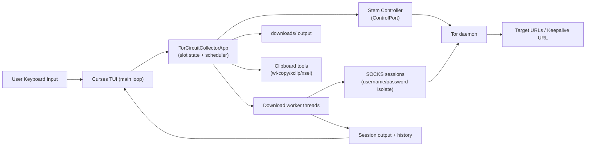
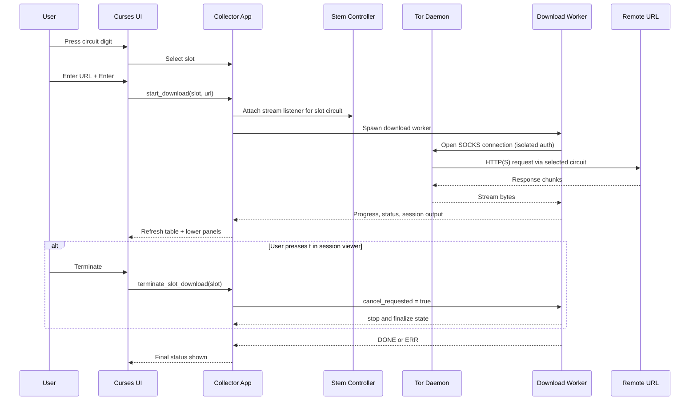

# tor-circuit-collector

`tor-circuit-collector` is a Python terminal application that maintains a small pool of Tor circuits, keeps idle circuits warm, and lets you choose a numbered circuit for an HTTP(S) download such as a PDF or EPUB.

The interface uses an in-place `curses` display, so status refreshes do not scroll the terminal. By default, it maintains **9 circuits** and refreshes the CLI every **5 seconds**.

## Files

```text
tor-circuit-collector.py      Main Python CLI application
tor-circuit-collector.sh      Bash runner that works from any current directory
tor-circuit-collector.json    JSON configuration file
README.md                     This file
```

## What it does

- Connects to Tor through the Tor ControlPort.
- Probes nearby/common Tor control ports if the configured control port is unavailable.
- Builds controller-owned Tor circuits.
- Keeps the configured number of circuits available.
- Rebuilds a circuit if Tor reports it as closed or failed.
- Runs periodic keep-alive requests on idle circuits.
- Auto-selects a reachable SOCKS port using Tor listener info when the configured SOCKS port is unreachable.
- Lets the user press a circuit number and enter a download URL.
- Streams downloads through the selected circuit using Tor SOCKS credentials and stream attachment.
- Shows download progress in place without extra scrolling lines.
- Saves completed downloads to the configured output directory.

## Architecture

### Component view



### Download flow



## Requirements

- Python 3.8 or newer is recommended.
- Tor must be installed and running locally or on a reachable host.
- Python packages:

```bash
python3 -m pip install stem "requests[socks]"
```

On Debian or Ubuntu systems, Tor can usually be installed with:

```bash
sudo apt update
sudo apt install tor
```

## Tor configuration

The script needs both a SOCKS port and a ControlPort.

A minimal `torrc` example:

```torrc
SocksPort 9050 IsolateSOCKSAuth
ControlPort 9051
CookieAuthentication 1
```

With this setup, the script can usually authenticate through Tor cookie authentication without a control password.

If you use password authentication instead, configure Tor accordingly and set `control_password` in `tor-circuit-collector.json`, or pass `--control-password` on the command line.

## Quick start

Put these files in the same directory:

```text
tor-circuit-collector.py
tor-circuit-collector.sh
tor-circuit-collector.json
```

Make the runner executable if needed:

```bash
chmod +x tor-circuit-collector.sh
```

Run it:

```bash
./tor-circuit-collector.sh
```

The runner resolves the Python script relative to its own path, so it can be invoked from any current working directory:

```bash
/path/to/tor-circuit-collector.sh
```

You can also place a symlink to `tor-circuit-collector.sh` somewhere on your `PATH`, as long as the real script target remains next to `tor-circuit-collector.py`.

## Using the terminal UI

Once running:

### Key Cheat Sheet

| Key | Context | Action |
|---|---|---|
| `1`..`9` | Main screen | Select circuit. If actively downloading, opens session viewer. Otherwise opens URL prompt for that circuit. |
| `R` / `r` | Main screen | Retry failed download(s). If exactly one failed circuit exists, retries immediately. If multiple exist, opens retry selector. |
| `N` / `n` | Main screen | Open replace selector. Press circuit digit to replace that circuit with a newly built one immediately. |
| `X` / `x` | Main screen | Open clear selector. Press circuit digit to clear that slot state to ready without rebuilding. |
| `C` / `c` | Main screen | Open copy selector. Press circuit digit to copy that slot URL to clipboard immediately. |
| `P` / `p` | Main screen | Read URL from clipboard and start it on the next available circuit. |
| `H` / `h` | Main screen | Open successful download history (most recent first). |
| `F` / `f` | Main screen | Open failed download history (excluding URLs that later succeeded). |
| `q` | Main screen | Quit application. |
| Digit (`1`..`9`) | Retry selector | Retry that circuit immediately (no Enter). |
| Digit (`1`..`9`) | Replace selector | Replace that circuit immediately (no Enter). Active transfer is interrupted first. |
| Digit (`1`..`9`) | Clear selector | Clear that circuit slot state to ready immediately (no Enter). |
| Digit (`1`..`9`) | Copy selector | Copy that circuit URL immediately (no Enter). |
| `Esc` | Any selector/prompt | Cancel current selector/prompt. |
| `Enter` | URL prompt | Submit URL for selected circuit. |
| `c` | Session viewer | Continue (close viewer). |
| `t` | Session viewer | Terminate active download for viewed circuit. |
| `Up` / `Down` or `k` / `j` | Session viewer | Scroll output. |
| `PageUp` / `PageDown` | Session viewer | Scroll faster. |
| `Up` / `Down` or `k` / `j` | Success/Failed history viewer | Scroll history. |
| `PageUp` / `PageDown` | Success/Failed history viewer | Scroll history faster. |
| `c` / `C` | Success/Failed history viewer | Clear the currently displayed history list. |
| `h` or `Esc` | Success history viewer | Close success history viewer. |
| `f` or `Esc` | Failed history viewer | Close failed history viewer. |

### Common Workflows

Recover a failed download quickly:

1. Press `R`.
2. If only one failed circuit exists, retry starts immediately.
3. If a selector appears, press the failed circuit digit to retry immediately.

Replace a circuit that looks unhealthy:

1. Press `N`.
2. Press the circuit digit.
3. The app interrupts any active transfer on that slot, then builds a fresh circuit.

Clear a slot to ready without rebuilding:

1. Press `X`.
2. Press the circuit digit.
3. The app interrupts any active transfer, clears slot-local transfer/error state, and returns the slot to `ready`.

Start next URL from clipboard:

1. Copy a full `http://` or `https://` URL to your system clipboard.
2. Press `P`.
3. The app selects the next available circuit and starts the download immediately.

### Detailed Notes

No Enter needed for these actions:

- Pressing a circuit digit on the main screen acts immediately.
- Retry selector (`R`) uses immediate digit selection.
- Replace selector (`N`) uses immediate digit selection.
- Clear selector (`X`) uses immediate digit selection.
- Copy selector (`C`) uses immediate digit selection.

- Press `1` through the configured circuit count (up to `9`) to select a circuit.
- If a circuit is actively downloading, pressing its number opens the lower-half session output viewer.
- In the session output viewer, press `c` to continue (close viewer) or `t` to terminate the active download.
- Press `R` to retry failed downloads.
- If exactly one failed circuit exists, `R` retries it immediately.
- If multiple failed circuits exist, `R` opens a retry prompt; press the circuit digit to retry immediately.
- Press `C` to open a copy prompt; press the circuit digit to copy that slot URL to clipboard immediately (no Enter).
- `C` copy works even when a transfer is active or failed, as long as that slot has a URL.
- Press `N` to open a replace prompt; press the circuit digit to replace that slot with a newly built circuit immediately (no Enter).
- `N` replace interrupts an active download on that circuit before rebuilding.
- Press `X` to open a clear prompt; press the circuit digit to clear that slot state to ready without rebuilding.
- `X` clear interrupts an active download on that circuit.
- `X` clear also removes stale transfer/error state for that slot (download summary, URL, byte counter, and slot-local output).
- Press `P` to paste the clipboard URL into the next available circuit and start immediately.
- Press `H` to open a scrollable successful-download history pane, with most recent entries at the top.
- Press `F` to open a scrollable failed-download history pane.
- Failed history excludes any URL that later succeeded.
- If a URL fails multiple times and has not succeeded yet, only its most recent failure is shown.
- Press `C` or `c` while viewing success history or failed history to clear that list.
- Optional terminal-dependent shortcuts: `Ctrl+<number>` retries a failed URL for that circuit, and `Alt+<number>` opens that circuit URL prompt prefilled from clipboard.
- Enter an absolute `http://` or `https://` URL.
- Press `Enter` to start the download.
- Press `Esc` while entering a URL to cancel the prompt.
- Press `q` to quit.

The UI shows each circuit's current Tor circuit ID, exit relay, age, keep-alive status, failure count, KB downloaded since last URL, average Mbps for the current/last transfer, and download progress.

Status display and colors:

- `ready` is shown in green.
- `downloading` is shown in cyan.
- `keep-alive` is shown in blue.
- Build/rebuild/queued/terminating states are shown in yellow.
- Failed/dropped/error states are shown in red.
- `ERR ...` in the Download column is shown in red and means the most recent attempt failed.
- A circuit may have downloaded some bytes before an `ERR` if the failure happened mid-transfer.

## Configuration

By default, the Python script loads:

```text
tor-circuit-collector.json
```

from the same directory as `tor-circuit-collector.py`.

You can use another config file with:

```bash
./tor-circuit-collector.sh --config /path/to/tor-circuit-collector.json
```

You can also set:

```bash
export TOR_CIRCUIT_COLLECTOR_CONFIG=/path/to/tor-circuit-collector.json
./tor-circuit-collector.sh
```

Command-line flags override JSON values.

### Suggested config

```json
{
  "tor": {
    "socks_host": "127.0.0.1",
    "socks_port": 9050,
    "socks_port_candidates": [9150],
    "control_host": "127.0.0.1",
    "control_port": 9051,
    "control_port_candidates": [9151],
    "control_port_scan_radius": 10,
    "port_probe_timeout": 0.6,
    "control_password": null
  },
  "collector": {
    "circuits": 9,
    "keepalive_url": "https://check.torproject.org/api/ip",
    "keepalive_interval": 60,
    "max_keepalive_failures": 2,
    "circuit_build_timeout": 90,
    "leave_circuits": false,
    "show_paths": false
  },
  "downloads": {
    "output_dir": "downloads",
    "keep_partials": false
  },
  "ui": {
    "status_interval": 5
  },
  "timeouts": {
    "connect_timeout": 20,
    "read_timeout": 30,
    "download_read_timeout": 120
  }
}
```

### Relative paths

If `downloads.output_dir` is relative, it is resolved relative to the config file location unless `--output-dir` is passed explicitly.

For example, this config entry:

```json
{
  "downloads": {
    "output_dir": "downloads"
  }
}
```

creates or uses a `downloads` directory beside the JSON config file.

## Command-line options

Run:

```bash
./tor-circuit-collector.sh --help
```

Common options:

```bash
./tor-circuit-collector.sh --config /path/to/config.json
./tor-circuit-collector.sh --output-dir ~/Downloads/tor
./tor-circuit-collector.sh --circuits 5
./tor-circuit-collector.sh --show-paths
./tor-circuit-collector.sh --keep-partials
./tor-circuit-collector.sh --control-port-candidates 9151,39051
./tor-circuit-collector.sh --socks-port-candidates 9150,39050
./tor-circuit-collector.sh --control-port-scan-radius 20
./tor-circuit-collector.sh --port-probe-timeout 1.0
```

Port discovery tuning:

- `tor.control_port_candidates`: additional control ports to try first.
- `tor.control_port_scan_radius`: probes `control_port +/- N`.
- `tor.socks_port_candidates`: additional SOCKS ports to probe.
- `tor.port_probe_timeout`: TCP probe timeout in seconds for port checks.

Boolean options support both positive and negative forms:

```bash
./tor-circuit-collector.sh --show-paths
./tor-circuit-collector.sh --no-show-paths
./tor-circuit-collector.sh --leave-circuits
./tor-circuit-collector.sh --no-leave-circuits
```

## How circuit selection works

The script uses Tor's control interface to build circuits and temporarily sets:

```text
__LeaveStreamsUnattached=1
```

This lets the controller attach new SOCKS streams to the selected circuit. Each circuit slot uses distinct SOCKS credentials, and stream events are mapped back to the corresponding numbered slot.

On shutdown, the script attempts to restore the previous `__LeaveStreamsUnattached` value and close controller-built circuits unless `leave_circuits` is enabled.

## Downloads

Downloads are streamed in chunks and written first to a `.part` file. When a download completes, the `.part` file is atomically moved to the final filename.

If the server provides a `Content-Disposition` filename, that name is used. Otherwise, the filename is inferred from the final response URL (path and common filename query parameters). Existing filenames are not overwritten; the script appends `-1`, `-2`, and so on.

Filename post-processing is applied before writing files:

- Names are normalized (unsafe path/control characters removed, whitespace collapsed).
- Very long names are shortened to keep them manageable while preserving the file extension.
- If the filename has no extension (or only `.bin`), the app tries to infer one from HTTP `Content-Type` and URL filename hints (for example `.pdf` or `.epub`).
- If no reliable extension can be inferred, the app forces a `.bin` extension so files are never saved extensionless.

History persistence:

- Successful download history is persisted in the script directory as `tor-circuit-collector.success-history.jsonl`.
- Failed download history is persisted in the script directory as `tor-circuit-collector.failed-history.jsonl`.
- Failed history is cross-checked against successful URLs so entries are hidden/removed once that URL eventually succeeds.
- In failed history, only the most recent unresolved failure per URL is shown in the viewer.

By default, failed partial downloads are removed. To keep them:

```bash
./tor-circuit-collector.sh --keep-partials
```

or set:

```json
{
  "downloads": {
    "keep_partials": true
  }
}
```

## Troubleshooting

### `Could not connect/authenticate to Tor ControlPort`

Check that Tor is running and that `ControlPort` is enabled.

The collector now probes a small set of likely control ports automatically (the configured port, nearby ports, and common Tor defaults) before failing.

Example checks:

```bash
systemctl status tor
ss -ltnp | grep -E '9050|9051'
```

Also confirm that your `tor-circuit-collector.json` uses the same host and port values as Tor.

### Missing Python dependencies

Install the required packages:

```bash
python3 -m pip install stem "requests[socks]"
```

### Terminal too small

Use a terminal window at least 80 columns wide and 13 rows high.

### Clipboard operations with `C` or `P` do not work

Install one of these clipboard tools so the app can read/write clipboard text:

```bash
sudo apt install wl-clipboard
# or
sudo apt install xclip
# or
sudo apt install xsel
```

### Downloads fail but circuits stay alive

Some servers block Tor exits, require JavaScript, require cookies, or reject automated clients. Try a different URL or a different document source.

### Circuits build slowly

Tor circuit construction can take time. Increase the build timeout if needed:

```json
{
  "collector": {
    "circuit_build_timeout": 120
  }
}
```

## Notes and limitations

- Only absolute `http://` and `https://` URLs are supported.
- The UI supports single-digit circuit selection, so `circuits` must be between 1 and 9.
- This tool does not make downloads anonymous by itself; your anonymity depends on Tor, your system configuration, destination behavior, document contents, and operational choices.
- Opening downloaded PDFs or EPUBs in external applications may leak information outside Tor if those applications fetch remote resources.
- Use this only for lawful downloads and with respect for the destination site's terms and rate limits.

## Example layout

```text
~/tools/tor-circuit-collector/
├── tor-circuit-collector.py
├── tor-circuit-collector.sh
├── tor-circuit-collector.json
├── README.md
└── downloads/
```

Run from anywhere:

```bash
~/tools/tor-circuit-collector/tor-circuit-collector.sh
```
